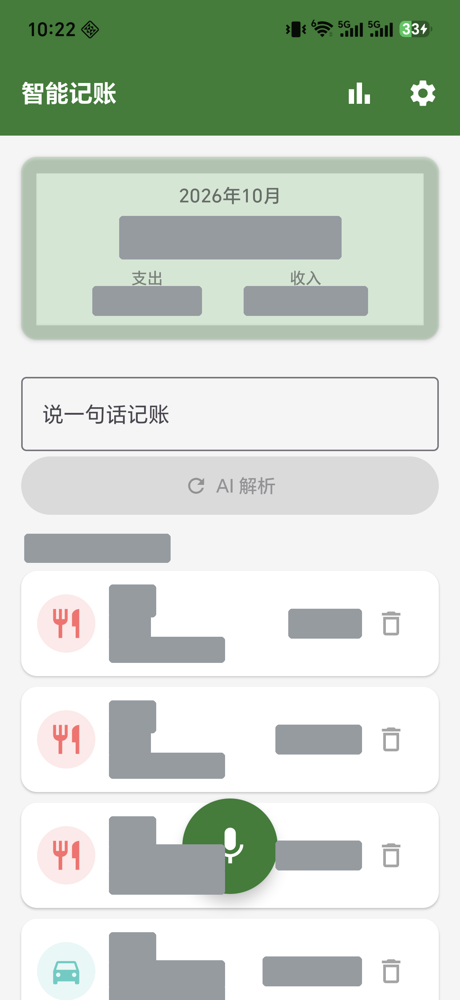
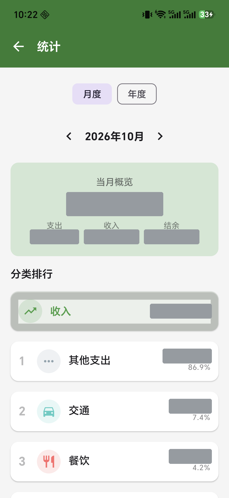
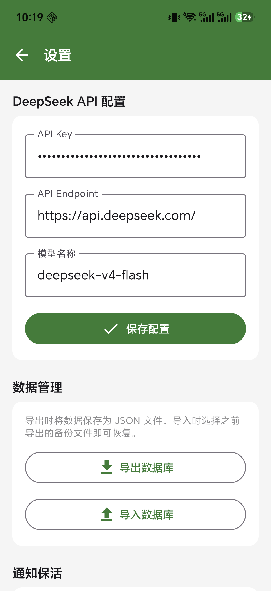

# 智能记账 · ExpenseTracker

说一句话，自动记一笔账。Android 端离线语音记账应用：录音在本机转成文字，再由 AI 解析成结构化账单。

> **录音不出设备。** 离线语音识别完全在手机本地推理，音频不上传、不落盘；只有识别出的**文字**会发送到你配置的 AI 服务用于解析。

---

## 下载

前往 [**Releases**](https://github.com/airliu23/ExpenseTracker/releases/latest) 下载最新 APK：

| 文件 | 说明 |
|------|------|
| [`ExpenseTracker-v1.4.1-release.apk`](https://github.com/airliu23/ExpenseTracker/releases/download/v1.4.1/ExpenseTracker-v1.4.1-release.apk) | release 签名 · 343 MB |

直接安装即可，无需自行编译（238 MB 的离线语音模型已打包在内）。

> **签名密钥已更换**：本版起改用新的 release 密钥签名。此前用 debug 密钥签名的 v1.3.0 无法覆盖升级，需先卸载 —— 建议先在「设置 → 导出数据库」备份，安装后再导入。

---

## 界面

| 首页 | 统计 | 设置 |
|:----:|:----:|:----:|
|  |  |  |

---

## 功能

- **离线语音识别** —— 基于 FunASR Paraformer 的 ONNX 模型本地推理，边说边出字，松开即出结果
- **AI 语义解析** —— 把「中午吃饭三十五」这类口语解析成金额 / 分类 / 日期 / 备注，容忍同音字、漏字、口误
- **自动分类** —— 餐饮、交通、购物、娱乐、居住、医疗、教育、通讯、其他支出、收入
- **账单管理** —— 按日期分组的消费列表，支持手动记账、备注与自定义分类
- **数据统计** —— 本月收支概览、分类占比饼图、月度趋势、分类排行，点进分类可看每笔明细
- **隐私优先** —— 账本存本地 Room 数据库，API Key 加密存储；无账号体系、无广告、无统计 SDK
- **数据导出导入** —— JSON 格式，经系统文件选择器读写，方便备份与迁移
- **月度概览** —— 常驻通知推送当月账单摘要，内置看门狗在服务被系统清理后自动拉起

---

## 技术栈

| 层次 | 选型 |
|------|------|
| 语言 | Kotlin 2.0.21 |
| UI | Jetpack Compose + Material 3（Compose BOM 2024.12.01） |
| 架构 | MVVM + Clean Architecture（data / domain / ui 三层） |
| 数据库 | Room 2.7.0 |
| 网络 | Retrofit 2.11 + OkHttp 4.12 + Moshi 1.15 |
| 依赖注入 | Hilt 2.51.1 |
| 导航 | Navigation Compose 2.8.5 |
| 图表 | Vico 2.0.0-beta.2 |
| 语音识别 | ONNX Runtime Android 1.27.0 + JTransforms 3.2（自实现 Fbank / LFR / CMVN） |
| AI 解析 | DeepSeek Chat API（兼容 OpenAI 接口格式） |
| 构建 | AGP 8.7.3 / Gradle 8.11.1 / JDK 17 |

Android 版本：`minSdk 26`（Android 8.0）/ `targetSdk 36` / `compileSdk 36`

---

## 架构

```
语音输入 ──► FunAsrVoiceService      前台服务录音（AudioRecord）
             │
             ├─► FunAsrEngine        Fbank → LFR → CMVN → ONNX 推理 → BPE 解码（全内存）
             │
             ▼
        识别文本 ──► ParseVoiceExpenseUseCase
             │
             ├─► DeepSeekRepository  POST /chat/completions（文字，非音频）
             │
             ▼
        ExpenseParseResult ──► AddExpenseUseCase ──► ExpenseRepository ──► Room
```

目录结构：

```
app/src/main/java/com/example/expensetracker/
├── data/
│   ├── local/          Room 数据库、DAO、Entity
│   ├── remote/         DeepSeek API 接口与 DTO
│   └── repository/     数据仓库
├── domain/
│   ├── model/          领域模型
│   └── usecase/        业务用例
├── ui/                 Compose 界面（home / add / statistics / settings / components / theme / navigation）
├── service/            FunASR 语音识别服务、月度概览服务、开机广播
└── di/                 Hilt 依赖注入模块
```

---

## 构建

### 环境要求

- JDK 17
- Android SDK，需安装 **Android 36 (API 36)** 平台与对应 build-tools
- Gradle 8.11.1

### 首次准备

仓库**不包含**以下内容，克隆后需先补齐：

**1. 离线语音模型（必需）**

`paraformer_nano.onnx` 约 238 MB，超出仓库体积限制，已被 `.gitignore` 排除。你需要自行获取并放置到：

```
app/src/main/assets/funasr/paraformer_nano.onnx
```

同目录下的 `tokens.json`、`cmvn_mean.bin`、`cmvn_invstd.bin`、`am.mvn` 已在仓库中，无需处理。

**2. Gradle Wrapper（必需）**

仓库中未包含 `gradlew` / `gradlew.bat` / `gradle-wrapper.jar`，请任选其一：

- 用本机已安装的 Gradle 8.11.1 直接构建；或
- 执行 `gradle wrapper --gradle-version 8.11.1` 生成 wrapper；或
- 直接用 Android Studio 打开工程构建（Studio 使用内置 Gradle，无需 wrapper）

**3. 本地 SDK 路径**

在项目根目录创建 `local.properties`：

```properties
sdk.dir=/path/to/Android/Sdk
```

### 构建命令

```bash
gradle assembleDebug        # Debug APK
gradle assembleRelease      # Release APK，读取 keystore.properties 签名
```

Release 签名配置从项目根目录的 `keystore.properties` 读取（该文件已被 `.gitignore` 忽略，密钥不入库）：

```properties
storeFile=/path/to/your-release.jks
storePassword=******
keyAlias=your-alias
keyPassword=******
```

文件不存在时 `assembleRelease` 仍可执行，只是产物未签名，便于他人克隆后自行构建。

产物位于 `app/build/outputs/apk/`。

> **注意**：打包出的 APK 约 **343 MB**（release，经 R8 混淆）/ **360 MB**（debug），因为 238 MB 的离线语音模型未压缩地打进了包里。这是该方案的固有代价。

---

## 使用前配置

应用**不内置** API Key，首次使用需在「设置」页填写：

| 配置项 | 默认值 | 说明 |
|--------|--------|------|
| API Key | 空 | 你的 DeepSeek API Key，加密存储于设备本地 |
| API Endpoint | `https://api.deepseek.com/` | 兼容 OpenAI 接口格式，可指向其他服务 |
| 模型名称 | `deepseek-v4-flash` | 可替换为其他兼容模型 |

未填写 API Key 时，语音解析不可用，但手动记账、统计、导出等全部功能正常。

---

## 权限说明

| 权限 | 用途 |
|------|------|
| `RECORD_AUDIO` | 录制语音，用于**本地**识别 |
| `INTERNET` | 调用你配置的 AI 服务解析识别文本 |
| `ACCESS_NETWORK_STATE` | 判断网络可用性 |
| `POST_NOTIFICATIONS` | 显示录音状态与月度概览通知 |
| `FOREGROUND_SERVICE` / `FOREGROUND_SERVICE_MICROPHONE` | 录音期间保持识别服务运行 |
| `FOREGROUND_SERVICE_SPECIAL_USE` | 月度账单概览通知 |
| `RECEIVE_BOOT_COMPLETED` | 开机后恢复月度概览提醒 |

---

## 隐私

- **录音不离开设备**：音频仅存在于内存中，识别完成即释放，不写文件、不上传
- **只有文字会被上传**：识别出的文本可能包含消费内容，会发送到你配置的 AI 服务端点
- **账本仅存本地**：Room 数据库位于应用私有目录，无服务端、无账号
- **无第三方采集**：不含广告、统计埋点或崩溃上报 SDK

---

## 已知问题

- **APK 体积大（release 约 343 MB）**：离线模型 238 MB 且设置了不压缩，无法通过代码瘦身
- **应用图标**：`drawable-xhdpi/ic_launcher_foreground.png` 是一张不透明位图，作为自适应图标前景层会遮住背景色；且它与 `drawable/ic_launcher_foreground.xml` 同名冲突，实际生效的是前者
- **发布版日志**：`HttpLoggingInterceptor` 当前为 `BODY` 级别且未区分构建类型，release 包同样会输出请求内容到 logcat
- **无测试**：项目尚未包含任何单元测试或仪器测试
- **双击电源键**：`PLAN.md` 中规划了这一入口，但尚未实现（无对应的 AccessibilityService）

---

## 许可证

[MIT](LICENSE) © 2026 airliu
